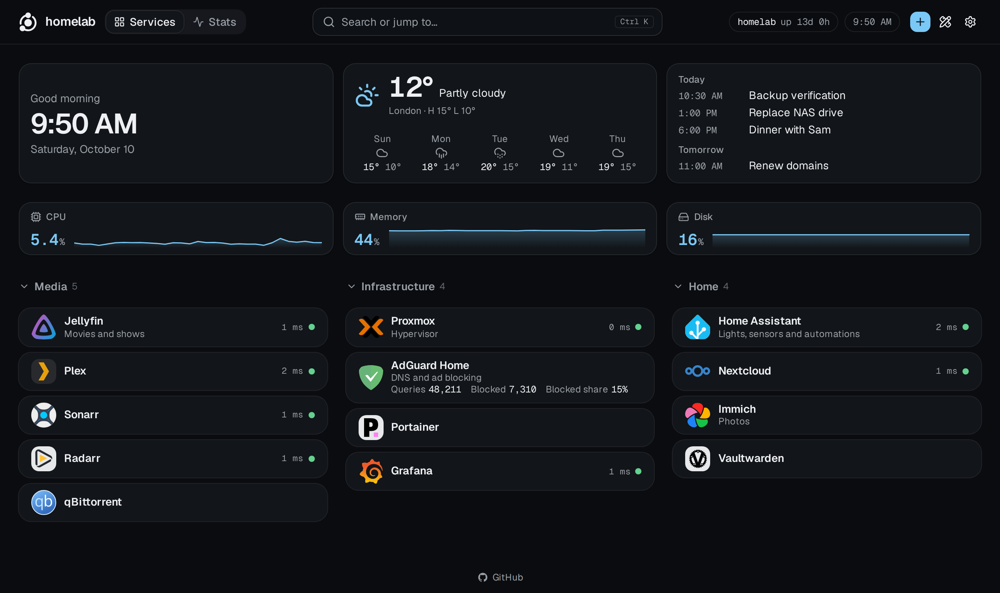

<p align="center">
  
</p>

<p align="center">
  <a href="https://github.com/chriscorbell/orbitdash/actions/workflows/docker-publish.yml?branch=main" target="_blank">
    
  </a>
</p>

<br/>

<p align="center">
  <b>orbitdash</b> is <i>yet another</i> modern server dashboard, <br>inspired by <a href="https://github.com/MauriceNino/dashdot" target="_blank">dashdot</a>, <a href="https://github.com/bastienwirtz/homer" target="_blank">homer</a> and <a href="https://github.com/ajnart/homarr" target="_blank">homarr</a>.
</p>

<p align="center">
  It is intended for use on home/private servers.
</p>

<p align="center">
  Built with TypeScript, React, TailwindCSS, shadcn/ui, Vite, Bun, Hono and SQLite.
</p>

<p align="center">
  <a href="https://github.com/chriscorbell/orbitdash/pkgs/container/orbitdash" target="_blank">Container Image (GHCR)</a>
</p>

Container tags follow three channels:

- `latest` and `main` are rolling tags updated from every validated push to `main`, except
  documentation-only changes.
- `sha-<commit>` identifies the build produced from one Git commit.
- `vX.Y.Z` identifies a stable release whose tag matches the version in `package.json`.

For an immutable deployment or rollback, pin the manifest digest as
`ghcr.io/chriscorbell/orbitdash@sha256:<digest>`; registry tags can be republished.

`package.json` is the single source for stable release versions. Its initial `0.0.0` value means
that no stable release has been cut yet; the first release PR replaces it with the chosen semantic
version before creating the matching tag.

## Preview



## Features

- Live CPU, memory and disk usage in a compact strip with sparklines
- A Stats page: per-core load, memory, network, disk activity, storage per mount and temperatures, live or over the last hour, day, week or month
- Threshold alerts for CPU, memory, any disk and CPU temperature, with a duration before they fire, shown on the dashboard and the Stats page
- Clock, weather (Open-Meteo, no API key) and calendar agenda (iCal links) widgets, as a row above the board or pills in the header
- Docker containers with state, health, CPU, memory and published ports, live from Docker's event stream
- Simple service links with icons and categories; dark icons get a light plate automatically
- Optional status checks per service (HTTP or TCP): a status dot and response time on the card, and a 24h uptime bar on hover
- Icons from the dashboard-icons and selfh.st libraries, suggested from the service name, or upload your own or paste a link
- Paste a link when adding a service and its name and icon fill in from the page; a Test button checks it before saving
- A command palette (⌘K, `/`, or just start typing): open services, run actions, or search the web with DuckDuckGo, Google, Bing, Brave or your own SearXNG
- UI-native service management (no config file needed)
- Categories as balanced columns or stacked rows, with compact, card or tile styles
- Edit mode: drag cards and categories, rename categories in place, add services to a category
- A wallpaper with blur and dim, your own dashboard name, an accent-colored favicon, and custom CSS
- Settings follow you across browsers, with optional per-device overrides (e.g. a wall tablet)
- Collapse category sections with saved per-browser state
- Import services from Homepage, Dashy, Homer, Homarr or browser bookmarks, with a preview to pick from
- Export and import everything as one file, with automatic nightly and pre-upgrade snapshots
- Deleting a service can be undone for 30 minutes
- Optional sign-in with a password or your sign-in proxy (Authelia, Authentik, Tailscale Serve),
  with an optional read-only view for guests
- Installable as an app on phones and desktops, and opens with your last known services while the
  server is unreachable (needs https, see below)

## Platform Support

- x86_64
- aarch64

## Installation Options

#### Docker Run

```bash
docker run -d \
  --name orbitdash \
  --restart unless-stopped \
  -p 7770:3000 \
  -v ./orbitdash-data:/data \
  ghcr.io/chriscorbell/orbitdash:latest
```

#### Docker Compose

```yaml
services:
  orbitdash:
    container_name: orbitdash
    image: ghcr.io/chriscorbell/orbitdash:latest
    restart: unless-stopped
    ports:
      - "7770:3000"
    volumes:
      - ./orbitdash-data:/data
```

After deployment, the dashboard is accessible at `http://<IP-ADDRESS>:7770`.

Change `7770` in the docker run/compose examples above if you want to serve the dashboard on a different port.

## Install As An App

Browsers only allow installing a web app, and keeping it available offline, over https (or on
`localhost`). Put orbitdash behind a reverse proxy with a certificate, or use something like
`tailscale serve`, then:

- iPhone and iPad: open it in Safari, tap Share, then Add to Home Screen.
- Android: open it in Chrome and tap Install app (or Add to Home screen) in the menu.
- Desktop Chrome or Edge: use the install icon in the address bar.

The installed app opens full screen. When the server can't be reached, it still opens with the last
services, categories and settings it saw; live stats come back once the server does. Over plain
http everything else works the same, just not installed or offline.

## Authentication

orbitdash is open by default, which suits a dashboard that only your own network can reach. To
require a sign-in, set `ORBITDASH_AUTH`:

- `password`: one shared password; each browser that signs in gets a session cookie.
- `proxy`: a reverse proxy that already signs people in (Authelia, Authentik, Tailscale Serve)
  names the user in a header, and orbitdash trusts it from that proxy only.

Auth is set only through environment variables, so nothing in the dashboard can turn it off.
orbitdash refuses to start with an incomplete or contradictory setup (password mode without a
password, proxy mode without trusted proxies, a password while auth is off) and logs what to fix.

| Variable                    | Default       | Purpose                                                                                                                                                                               |
| --------------------------- | ------------- | ------------------------------------------------------------------------------------------------------------------------------------------------------------------------------------- |
| `ORBITDASH_AUTH`            | `none`        | `none`, `password` or `proxy`                                                                                                                                                         |
| `ORBITDASH_PASSWORD`        | unset         | Password mode: the password. Hashed with argon2id when the server starts                                                                                                              |
| `ORBITDASH_PASSWORD_HASH`   | unset         | Password mode: an argon2id hash to use instead of the plain password (set one of the two)                                                                                             |
| `ORBITDASH_SESSION_DAYS`    | `30`          | How long a sign-in lasts without use, 1 to 400; using the dashboard extends it                                                                                                        |
| `ORBITDASH_GUEST`           | `none`        | `view` lets anyone see the dashboard read-only; changes need a sign-in                                                                                                                |
| `ORBITDASH_PROXY_HEADER`    | `Remote-User` | Proxy mode: the header that names the user                                                                                                                                            |
| `ORBITDASH_TRUSTED_PROXIES` | unset         | IPs or CIDR ranges (IPv4 or IPv6, comma-separated) of your reverse proxies. Required in proxy mode; in password mode it lets orbitdash read `X-Forwarded-For` and `X-Forwarded-Proto` |

With auth on, every `/api` route needs a session (or the proxy's user), including the live event
stream, icons, wallpapers and backups. The health checks (`/healthz`, `/readyz`, `/api/health`) and
the sign-in routes stay open, and so do the page and its scripts, so the sign-in screen can load.
With `ORBITDASH_GUEST=view`, anyone can read the dashboard and a Sign in button appears in the
header; adding, editing, settings and backups still need a sign-in.

### Password

```yaml
services:
  orbitdash:
    container_name: orbitdash
    image: ghcr.io/chriscorbell/orbitdash:latest
    restart: unless-stopped
    ports:
      - "7770:3000"
    environment:
      - ORBITDASH_AUTH=password
      # Every $ in the hash is doubled, because Compose treats $ as the start of a variable.
      - ORBITDASH_PASSWORD_HASH=$$argon2id$$v=19$$m=65536,t=2,p=1$$...
      # - ORBITDASH_GUEST=view
    volumes:
      - ./orbitdash-data:/data
```

Create the hash with the image itself. It asks for the password twice without showing it, so the
password stays out of your shell history, and prints the hash plus a copy with every `$` doubled
for `docker-compose.yml`:

```bash
docker run --rm -it ghcr.io/chriscorbell/orbitdash:latest bun server/cli/hash-password.ts
# or, with orbitdash already running:
docker exec -it orbitdash bun server/cli/hash-password.ts
# or, from a checkout of this repository:
bun run hash-password
```

`ORBITDASH_PASSWORD=...` works too; orbitdash then hashes it at startup and never stores it in
plain text. Changing the password and restarting signs every browser out.

Sessions are random 32-byte tokens in an `HttpOnly`, `SameSite=Lax` cookie, marked `Secure` over
https (directly, or when a trusted proxy sends `X-Forwarded-Proto: https`). The database stores only
a SHA-256 of each token. Signing out ends the session on the server. After 5 wrong passwords from
one address within 15 minutes, that address has to wait (the sign-in screen shows how long).
Failed attempts are logged with the client's address, never with the password.

### Behind a sign-in proxy

orbitdash trusts the user header only on connections from an address in
`ORBITDASH_TRUSTED_PROXIES`, judged by the connection itself, not by `X-Forwarded-For`. The same
header from anywhere else is ignored and logged as `auth.proxy_header_ignored` with the address it
came from, which also tells you the right address when the list is wrong. Keep that list tight:
anything that can connect from a trusted address can claim to be anyone. Don't let clients reach
orbitdash around the proxy from such an address, for example by publishing the port only on
`127.0.0.1` or not at all.

Authelia or Authentik, with forward auth in front of orbitdash (Traefik, Caddy or nginx):

```yaml
services:
  orbitdash:
    container_name: orbitdash
    image: ghcr.io/chriscorbell/orbitdash:latest
    restart: unless-stopped
    # No published port: only the reverse proxy, on the same network, reaches orbitdash.
    networks:
      proxy:
        ipv4_address: 172.30.0.10
    environment:
      - ORBITDASH_AUTH=proxy
      # Authelia sends Remote-User; Authentik's proxy outpost sends X-authentik-username.
      - ORBITDASH_PROXY_HEADER=Remote-User
      # The reverse proxy's fixed address on that network.
      - ORBITDASH_TRUSTED_PROXIES=172.30.0.2
    volumes:
      - ./orbitdash-data:/data

networks:
  proxy:
    external: true
```

Have the reverse proxy copy the header from the auth response onto the request, which also replaces
any value a client sent: Traefik's `authResponseHeaders`, Caddy's `copy_headers` in
`forward_auth`, or `auth_request_set` with `proxy_set_header` in nginx.

Tailscale Serve sends `Tailscale-User-Login` for people on your tailnet and strips that header from
what clients send. It proxies to `127.0.0.1` on the host, so the simplest setup runs orbitdash on
the host network, where those connections arrive from `127.0.0.1`:

```yaml
services:
  orbitdash:
    container_name: orbitdash
    image: ghcr.io/chriscorbell/orbitdash:latest
    restart: unless-stopped
    network_mode: host
    environment:
      - PORT=7770
      - ORBITDASH_AUTH=proxy
      - ORBITDASH_PROXY_HEADER=Tailscale-User-Login
      - ORBITDASH_TRUSTED_PROXIES=127.0.0.1
      # Optional: people reaching port 7770 directly, outside Tailscale, can look but not edit.
      # - ORBITDASH_GUEST=view
    volumes:
      - ./orbitdash-data:/data
```

Then run `tailscale serve --bg 7770` on the host. Funnel (public) traffic carries no identity, so it
gets the sign-in screen, or the read-only view with guest access on. The signed-in user's name is
shown in Settings.

## Data Persistence

All data is stored under `/data` inside the container:

- `orbitdash.db` (SQLite database)
- `icons/` (uploaded/downloaded service icons)
- `wallpapers/` (uploaded wallpapers; ones no setting uses are cleaned up after an hour)
- `cache/` (the icon library index, refreshed daily; safe to delete)
- `backups/` (automatic snapshots, the newest 7 by default; see `ORBITDASH_BACKUP_KEEP`)

The docker run/compose examples above bind-mount `/data` to `./orbitdash-data` in the current working host directory. You can change this to a different location on the host, or alternatively map to a volume instead if desired.

The container runs as the unprivileged `bun` user (uid 1000). A bind-mounted data directory must be
writable by that uid — if Docker created it as root, fix it once with `chown -R 1000:1000 ./orbitdash-data`.
Named volumes inherit the correct ownership automatically.

Outside Docker, orbitdash stores data in `./data` by default. You can override the storage path in any environment with `ORBITDASH_DATA_DIR=/path/to/data`.

For backup and restore steps, including SQLite WAL files and icon assets, see
[docs/backup-restore.md](docs/backup-restore.md).

The backend listens on port `3001` by default outside the container. Override it with `PORT=<port>`.

The disk metric uses `/` by default. Override it with `ORBITDASH_DISK_PATH=/path/to/mount` when you
need to track a different mount. With `ORBITDASH_HOST_ROOT` set (see below), this is a path on the
host, and the default `/` is the host's root filesystem.

Logs are JSON lines on stdout/stderr. `LOG_LEVEL` sets the minimum level written: `debug`, `info`
(default), `warn` or `error`. Successful health checks, icon and asset requests, and the live
event streams are logged at `debug`; other successful requests at `info`; 4xx responses at `warn`;
5xx responses at `error`.

## Importing From Another Dashboard

Settings → Data → **Import from another dashboard** reads these files:

| From              | File                                                      |
| ----------------- | --------------------------------------------------------- |
| Homepage          | `services.yaml` (nested groups become their own category) |
| Dashy             | `conf.yml`                                                |
| Homer             | `config.yml`                                              |
| Homarr            | the JSON export of a board                                |
| Browser bookmarks | the HTML export from Chrome, Firefox, Safari or Edge      |

Nothing is added until you confirm. The preview shows every service with its icon, unticks links
that are already on your dashboard, and lets you rename each group's category. Icons named in the
file (`jellyfin.png`, `sh-jellyfin`, `hl-jellyfin`) or matching the service name are looked up in
the dashboard-icons and selfh.st libraries. Icon fonts such as `mdi-` or Font Awesome have no image
to copy, so those services come across without an icon. A snapshot is saved before anything is
added.

### Seeding a fresh install

To start a new install with services already in place, put a file in any of the formats above at
`/data/seed.yaml` (or point `ORBITDASH_SEED_FILE` at it). It is applied once, on the first start
with an empty dashboard; after that the UI is the source of truth and the file is ignored. The
simplest format is orbitdash's own:

```yaml
categories:
  - name: Media
    services:
      - name: Jellyfin
        url: http://10.0.0.20:8096
        description: Movies and shows
        icon: jellyfin # a dashboard-icons or selfh.st name, or an image URL
  - name: Infrastructure
    services:
      - name: Proxmox
        url: https://pve.lan:8006
```

## Host Metrics

orbitdash reads metrics straight from the kernel's `/proc` and `/sys`; there is no agent to install.
It collects:

- **CPU**: total and per-core usage, load average, frequency, and the CPU temperature
- **Temperatures**: hwmon sensors (`coretemp`, `k10temp`, NVMe drives and others), or thermal zones
  where there are none
- **Memory**: used, available, cache and swap
- **Filesystems**: size and use of every local filesystem; virtual, network, snap and container
  filesystems are left out
- **Disk I/O**: read and write rates per physical disk
- **Network**: receive and send rates per interface; loopback, Docker, bridge and VM interfaces are
  left out

`GET /api/metrics/host` returns the latest reading, and `GET /api/events?topics=host` streams a new
one every second. `GET /api/system` returns the hostname, OS, kernel, CPU model and uptime.
Anything that can't be read on a platform (macOS, or a restricted container) is left out rather
than failing.

orbitdash also keeps history, even when nobody has the dashboard open. It stores CPU, memory,
disk, load, CPU temperature, network and disk I/O at 1-minute resolution for 48 hours and
15-minute resolution for 90 days, which comes to about 2 MB in the data directory.
`GET /api/metrics/history?range=1h|24h|7d|30d` returns the average and peak of each metric per
point: 1-minute points for `1h`, 5-minute points for `24h`, and 15-minute points for `7d` and `30d`.

### Seeing the host from Docker

Inside a container, orbitdash already sees the host's CPU, memory, temperatures and disk I/O. It
only sees its own network interfaces, its own mounts and its image's OS name. To show the host's,
mount the host's root filesystem read-only and point `ORBITDASH_HOST_ROOT` at it:

```yaml
services:
  orbitdash:
    container_name: orbitdash
    image: ghcr.io/chriscorbell/orbitdash:latest
    restart: unless-stopped
    ports:
      - "7770:3000"
    environment:
      - ORBITDASH_HOST_ROOT=/mnt/host
    volumes:
      - ./orbitdash-data:/data
      - /:/mnt/host:ro
```

With `docker run`, add `-e ORBITDASH_HOST_ROOT=/mnt/host -v /:/mnt/host:ro`.

orbitdash then reads the host's `/proc`, `/sys`, mount table, `/etc/hostname` and `/etc/os-release`
under `/mnt/host`. The mount is read-only and the container still runs as its unprivileged user:
it needs no `privileged: true` and no extra capabilities. Use `/:/mnt/host:ro,rslave` instead if
drives you mount after the container starts should show up too.

If you only need the host's network interfaces, `network_mode: host` works without the mount.
Docker then ignores `ports:`, and the dashboard listens on the host's port `3000` (change it with
`PORT`).

## Docker Containers

With access to Docker, orbitdash shows a Containers tile in the stats strip (running out of total,
plus anything unhealthy, restarting or stopped) and a Containers list on the Stats page with each
container's state, health, CPU (as a share of the whole host), memory and published ports. Ports
link to the same host the dashboard was opened on. Updates arrive within a second of Docker
reporting a change; CPU and memory refresh every 15 seconds. orbitdash only ever reads from
Docker.

The safest setup is a [docker-socket-proxy](https://github.com/Tecnativa/docker-socket-proxy)
that only allows reading containers, so orbitdash never touches the socket itself:

```yaml
services:
  orbitdash:
    image: ghcr.io/chriscorbell/orbitdash:latest
    environment:
      - ORBITDASH_DOCKER_HOST=tcp://dockerproxy:2375
    # ...ports and volumes as above

  dockerproxy:
    image: ghcr.io/tecnativa/docker-socket-proxy:latest
    restart: unless-stopped
    environment:
      - CONTAINERS=1 # list and inspect containers
      - EVENTS=1 # live updates (on by default)
      - POST=0 # nothing can be changed
    volumes:
      - /var/run/docker.sock:/var/run/docker.sock:ro
```

Mounting the socket straight into orbitdash also works (`- /var/run/docker.sock:/var/run/docker.sock`),
but it gives the container full control of Docker: `:ro` on a socket doesn't stop writes. The
container runs as uid 1000, which also needs to be in the socket's group (`group_add:` with the
group id from `stat -c %g /var/run/docker.sock`). orbitdash finds a socket at
`/var/run/docker.sock` on its own; `ORBITDASH_DOCKER_HOST` (or `DOCKER_HOST`) takes
`tcp://host:port` or `unix:///path/to/socket`, and `ORBITDASH_DOCKER_HOST=off` turns Docker
support off.

## Status Checks

Status checks are off until you turn one on in a service's settings, so upgrading never makes
orbitdash contact anything new. A check runs from the server, every 15 seconds to 1 hour (1 minute
by default), against the service's link or a separate URL or `host:port`:

- **HTTP** sends a `HEAD` request (or `GET` if the service refuses `HEAD`), follows up to 5
  redirects, and never downloads the page. 2xx and 3xx answers count as up, and so do 401 and 403,
  since a login page still means the service answered. Self-signed certificates can be allowed per
  check.
- **TCP** only opens a connection to the port and closes it. There is no ping: the container runs
  without the privileges ICMP needs.

A check fails after 10 seconds without an answer. A service shows as slow when it answers in more
than 2 seconds, and as down after two failed checks in a row (the second one 15 seconds after the
first), so a single dropped request doesn't count as an outage. At most 8 checks run at once,
spread out so they don't all fire together.

Results are kept for 24 hours and hourly totals for 30 days. `GET /api/status` returns the current
status of every checked service, `GET /api/events?topics=status` streams each result, and
`GET /api/status/:id/history?range=24h|30d` returns the uptime history.

## Widgets

Settings → Widgets turns on any of three widgets, shown as a row above the board or as small
pills in the header:

- **Clock**: the time and date in large type, with an optional greeting. The time format (auto,
  12-hour or 24-hour) also applies to the header clock.
- **Weather**: current conditions and a five-day forecast from
  [Open-Meteo](https://open-meteo.com/), which needs no account or API key. Search for a place by
  name or postal code; °C or °F. The server fetches the forecast and caches it for ten minutes.
- **Agenda**: upcoming events from one or more iCal links (`https://` or `webcal://`, for example
  a Google, iCloud, Fastmail or Nextcloud calendar's secret address), for today or the next 3, 7
  or 14 days. Recurring events, moved and cancelled instances, and all-day events are handled.

Calendar links are often secret, so they stay on the server: the browser only ever sees each
calendar's name and host, plus event titles, times and locations. The server checks a link when it
is added, refreshes each calendar every 15 minutes, and reports a calendar that stops loading
without hiding the others. With [authentication](#authentication) on, guests can see the widgets
but only a signed-in user can add or remove calendars. Calendar links are included in backups.

## Health Checks

- `GET /healthz` returns liveness for process-level checks.
- `GET /readyz` returns readiness for deployment and CI probes, including a SQLite connectivity check.
- `GET /api/health` returns the same readiness payload as `readyz` for API-oriented clients.

## Deployment Verification

After deploying or upgrading the container, verify the service with:

```bash
curl --fail http://127.0.0.1:7770/healthz
curl --fail http://127.0.0.1:7770/readyz
```

Also confirm that:

- the host directory or volume mapped to `/data` is intact
- the expected host port is mapped to container port `3000`
- persisted services and icons still load after the restart

To roll back, resolve the previous `vX.Y.Z` or `sha-<commit>` image to its manifest digest, pin
`ghcr.io/chriscorbell/orbitdash@sha256:<digest>`, restart the container, and repeat the health
checks. Image rollback does not reverse database changes; keep a data backup from before each
upgrade.

## Testing

Use the following commands for the initial automated test workflow:

```bash
npm run test:e2e:install
npm run format
npm run format:check
npm run typecheck
npm run test:unit
npm run test:integration
npm run test:e2e
npm test -- --run
npm run test:coverage
```

Run `npm run test:e2e:install` once per machine before the first browser smoke test so Chromium is
available locally.

Formatting is enforced with Prettier. Use `npm run format` locally to normalize files and
`npm run format:check` to run the same check that CI uses.

The coverage gate reports shared, frontend, and server scopes separately. Shared runtime modules
remain at 100%; focused frontend application code and loaded server production modules use
baseline thresholds derived from their existing behavior tests. See [CONTRIBUTING.md](CONTRIBUTING.md#test-strategy)
for exact scope and thresholds.

## Validation Rules

Shared runtime validation now lives in `shared/schemas.ts` and is used by both the server routes
and the service dialog submit path. The current canonical rules are:

- service names are required after trimming
- service URLs must normalize to valid `http` or `https` URLs
- icon URLs, when provided, must normalize to valid `http` or `https` URLs
- remote icon downloads are limited to 2 MB, time out after 5 seconds, and verify the downloaded
  bytes match a supported image format
- category and description fields are trimmed and normalized to `null` when empty
- the `Uncategorized` section cannot be manually included in saved category ordering
- metrics `window` must be a positive integer and is bounded to 60 seconds (the sample retention period)
- metric history `range` must be `1h`, `24h`, `7d` or `30d` (default `1h`)

## Contributing

Issues and PRs are welcomed. Please include description, screenshots and any related logs.

For local workflows and project conventions, see [CONTRIBUTING.md](CONTRIBUTING.md),
[docs/architecture.md](docs/architecture.md), and [docs/release-checklist.md](docs/release-checklist.md).
