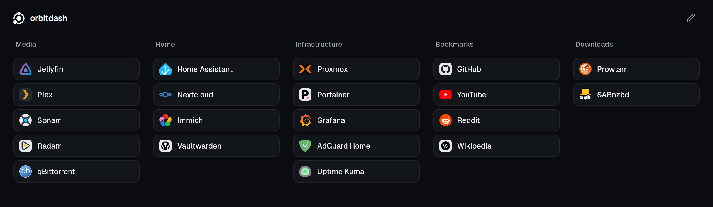

<p align="center">
  
</p>

<p align="center">
  <a href="https://github.com/chriscorbell/orbitdash/actions/workflows/docker-publish.yml?branch=main" target="_blank">
    
  </a>
</p>

<br/>

<p align="center">
  <b>orbitdash</b> is a startpage for your home server: your services and bookmarks as cards with<br>
  a title and an icon, grouped under headings, on one fast page.
</p>

<p align="center">
  <a href="https://github.com/chriscorbell/orbitdash/pkgs/container/orbitdash" target="_blank">Container image (GHCR)</a>
  ·
  <a href="https://github.com/chriscorbell/orbitdash/releases" target="_blank">Releases</a>
</p>

## Preview



## What it does

- Cards link to your services, with icons from the [dashboard-icons](https://github.com/homarr-labs/dashboard-icons) and [selfh.st](https://selfh.st/icons/) libraries or your own uploads.
- Categories sit in balanced columns that fit the window. Links without a category go above them.
- The pencil button switches to edit mode: add, edit and delete links and categories, and drag cards between categories. There's no config file.
- Everything lives in one SQLite file and an icon folder, in one small container for x86_64 and aarch64.

## Quick start

```bash
docker run -d \
  --name orbitdash \
  --restart unless-stopped \
  -p 7770:3000 \
  -v ./orbitdash-data:/data \
  ghcr.io/chriscorbell/orbitdash:latest
```

Then open `http://<server-ip>:7770` and add your first link. With Docker Compose:

```yaml
services:
  orbitdash:
    container_name: orbitdash
    image: ghcr.io/chriscorbell/orbitdash:latest
    ports:
      - "7770:3000"
    volumes:
      - ./orbitdash-data:/data
    restart: unless-stopped
```

orbitdash has no sign-in, and anyone who can open it can edit it. Keep it on your LAN or VPN, or put it behind a proxy that asks for a sign-in.

### Image tags

- `latest` and `main` follow every validated push to `main`.
- `vX.Y.Z` is a release; `sha-<commit>` is the build of one commit.
- To pin a deployment, use the digest: `ghcr.io/chriscorbell/orbitdash@sha256:<digest>`.

## Data

Everything is under `/data` in the container:

- `orbitdash.db`, the SQLite database
- `icons/`, the icon files
- `cache/`, the icon library index, refreshed daily and safe to delete

To back up, stop the container and copy the folder.

The container runs as the unprivileged `node` user (uid 1000), so a bind-mounted data folder must be writable by uid 1000. If Docker created it as root, fix it once with `chown -R 1000:1000 ./orbitdash-data`.

| Variable             | Default                                       |
| -------------------- | --------------------------------------------- |
| `PORT`               | `3000` in the container, `3001` outside it    |
| `ORBITDASH_DATA_DIR` | `/data` in the container, `./data` outside it |

## Upgrading from 1.x

2.0 drops everything except the links: metrics and the Stats page, status checks, alerts, notifications, Docker, integrations, widgets, importers, sign-in, Prometheus, themes, wallpapers and the settings page.

On its first start, 2.0 keeps each link's name, URL, icon, category and position, and removes the rest from `orbitdash.db`. Before it changes anything, it saves the whole 1.x database as `orbitdash-v1.db` in the same folder. To go back, stop the container, replace `orbitdash.db` with that copy, and run a 1.x image such as `ghcr.io/chriscorbell/orbitdash:v1.0.0`.

The 1.x environment variables, the host and Docker socket mounts, and the `backups/` and `wallpapers/` folders are no longer used. You can remove them.

## Development

Requires Node.js 24 and pnpm.

```bash
pnpm install
pnpm dev:all     # API on :3001 with reload, Vite on :5173
pnpm test        # unit and API tests
pnpm test:e2e    # builds, then runs Playwright against the production server
pnpm lint && pnpm typecheck && pnpm format:check
```

`pnpm build && pnpm start` runs the production server on port 3001, serving `dist/`.
